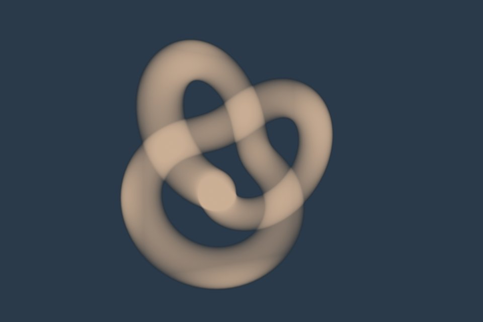
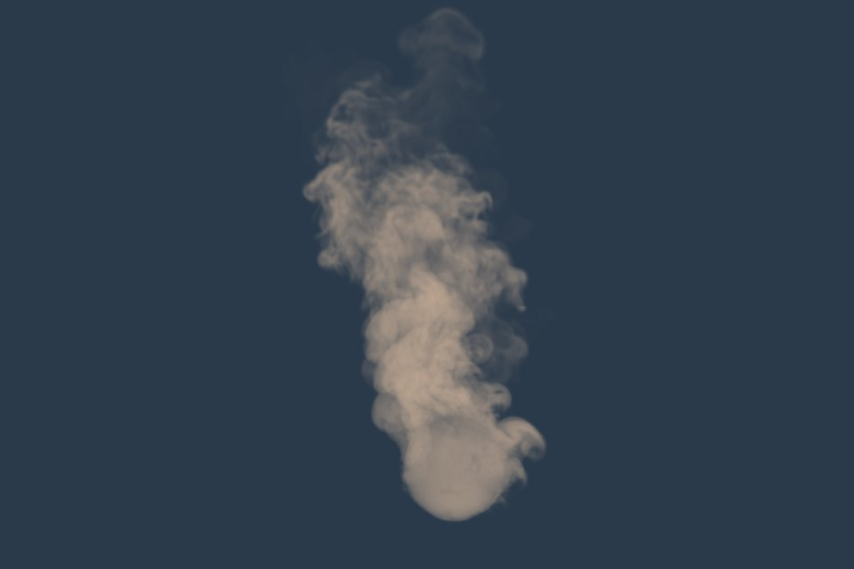
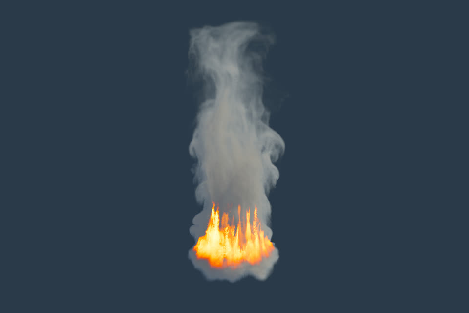
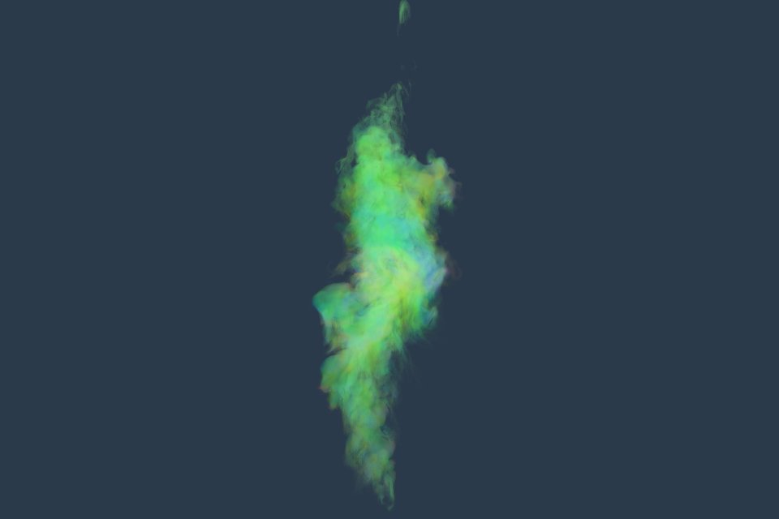

# three-vdb-loader

[OpenVDB](https://www.openvdb.org/) and [NanoVDB](https://github.com/AcademySoftwareFoundation/openvdb/tree/master/nanovdb) loader for three.js, [live demo](https://richardmonette.github.io/three-vdb-loader/examples/). OpenVDB is the industry standard for sparse volumes. NanoVDB packs the same data into a compact read-only layout, which makes it the better fit for the web: smaller files and far less work to decode.

<a href="https://richardmonette.github.io/three-vdb-loader/examples/"></a>

Above, 192 frames of NanoVDB, 31 MB, streamed and decoded in web workers while it plays ([mp4](media/fire_sequence.mp4)).

   

Above, single OpenVDB files: a torus knot fog volume, the openvdb.org smoke, its fire rendered from the density and temperature grids with the same model as the animation, and the velocity of the second smoke coloured by direction. Each grid becomes one `Data3DTexture`, raymarched in a fragment shader.

```
npm install three-vdb-loader
```

```html
<!DOCTYPE html>
<html>
<body style="margin: 0">
<script type="importmap">
{
	"imports": {
		"three": "https://cdn.jsdelivr.net/npm/three@0.186.1/build/three.module.js",
		"three/addons/": "https://cdn.jsdelivr.net/npm/three@0.186.1/examples/jsm/",
		"three-vdb-loader": "https://cdn.jsdelivr.net/npm/three-vdb-loader@0.4.2/VDBLoader.js"
	}
}
</script>
<script type="module">

import * as THREE from 'three';
import { OrbitControls } from 'three/addons/controls/OrbitControls.js';
import { VDBLoader } from 'three-vdb-loader';

const renderer = new THREE.WebGLRenderer();
renderer.setSize( innerWidth, innerHeight );
document.body.appendChild( renderer.domElement );

const scene = new THREE.Scene();
const camera = new THREE.PerspectiveCamera( 50, innerWidth / innerHeight, 0.1, 1000 );
const controls = new OrbitControls( camera, renderer.domElement );

const url = 'https://media.githubusercontent.com/media/AcademySoftwareFoundation/openvdb-website/master/download/models/smoke.vdb';
const [ grid ] = await new VDBLoader().setGridNames( [ 'density' ] ).loadAsync( url );

const material = new THREE.ShaderMaterial( {
	uniforms: { map: { value: grid.texture } },
	vertexShader: `
		varying vec3 vOrigin;
		varying vec3 vDirection;
		void main() {
			vOrigin = ( inverse( modelMatrix ) * vec4( cameraPosition, 1.0 ) ).xyz;
			vDirection = position - vOrigin;
			gl_Position = projectionMatrix * modelViewMatrix * vec4( position, 1.0 );
		}`,
	fragmentShader: `
		precision highp sampler3D;
		uniform sampler3D map;
		varying vec3 vOrigin;
		varying vec3 vDirection;
		void main() {
			vec3 dir = normalize( vDirection );
			vec3 t0 = ( - 0.5 - vOrigin ) / dir, t1 = ( 0.5 - vOrigin ) / dir;
			vec3 near = min( t0, t1 ), far = max( t0, t1 );
			float start = max( max( max( near.x, near.y ), near.z ), 0.0 );
			float end = min( min( far.x, far.y ), far.z );
			float step = ( end - start ) / 128.0;
			float alpha = 0.0;
			for ( int i = 0; i < 128; i ++ ) {
				alpha += ( 1.0 - alpha ) * texture( map, vOrigin + dir * ( start + float( i ) * step ) + 0.5 ).r * 0.05;
			}
			gl_FragColor = vec4( vec3( 1.0 ), alpha );
		}`,
	side: THREE.BackSide,
	transparent: true
} );

const center = grid.bbox.getCenter( new THREE.Vector3() );
const size = grid.bbox.getSize( new THREE.Vector3() ).addScalar( 1 );

const mesh = new THREE.Mesh( new THREE.BoxGeometry(), material );
mesh.matrixAutoUpdate = false;
mesh.matrix.copy( grid.transform ).multiply( new THREE.Matrix4().makeTranslation( center ).scale( size ) );
mesh.updateMatrixWorld( true );
scene.add( mesh );

const box = new THREE.Box3().setFromObject( mesh );
box.getCenter( controls.target );
camera.position.copy( controls.target ).add( new THREE.Vector3( 0, 0, box.getSize( new THREE.Vector3() ).length() ) );

renderer.setAnimationLoop( () => {

	controls.update();
	renderer.render( scene, camera );

} );

</script>
</body>
</html>
```

## Sequences

Animated volumes are a sequence of files, one per frame. `VDBSequenceLoader` fetches
them in order, decodes them in a pool of web workers a few frames ahead of playback
and updates one set of textures in place, so memory stays bounded whatever the length
of the sequence and playback starts as soon as the first frame is decoded.

```js
import { VDBSequenceLoader } from 'three-vdb-loader/sequence';

const sequence = await new VDBSequenceLoader()
	.setGridNames( [ 'density' ] )
	.setTextureType( THREE.UnsignedByteType )   // a quarter of the memory of float textures
	.loadAsync( 'models/fire/sequence.json', ( loaded, total ) => console.log( loaded + ' / ' + total ) );

material.uniforms.map.value = sequence.grids[ 0 ].texture;   // updated in place as frames change
sequence.play();

function animate() {

	sequence.update( timer.getDelta() );   // advances playback, never ahead of the decoded frames
	renderer.render( scene, camera );

}
```

`sequence.frame` seeks, `sequence.loop`, `pause()` and `dispose()` do what they say, and
`sequence.bbox` is the box all frames share. The manifest is a JSON file next to the frames:

```json
{ "fps": 24, "frames": [ "frame_000.nvdb", "frame_001.nvdb" ], "bbox": [ -6, -1, 9, 70, 91, 89 ],
  "valueRange": { "density": [ 0, 14.2 ] } }
```

`bbox` and `valueRange` are optional (the loader reads the box from the NanoVDB headers
and measures the range if needed) but they let every frame share one texture size and one
normalization. `node tools/manifest.mjs <directory> --fps 30` writes a manifest for a
directory of frames. Convert simulation frames with `nanovdb_convert --fp8 -z`: the
demo's 192 frame fire is 31 MB at 8 bits per voxel, 16 MB at 4. The demo sequences are locked (`tools/lock.mjs`, checked in CI) because the three.js example loads them from this repository's GitHub Pages site.

## Options

```js
const loader = new VDBLoader()
	.setGridNames( [ 'density' ] )              // grids to load, default: all
	.setTextureType( THREE.HalfFloatType )       // HalfFloatType (default), FloatType or UnsignedByteType
	.setBoundingBox( box3 )                      // index space box the textures cover, default: the active voxels
	.setValueRange( new THREE.Vector2( 0, 1 ) ); // range for UnsignedByteType normalization, default: measured
```

Each grid has `name`, `type`, `metadata`, `transform` (index to world space `Matrix4`),
`background`, `bbox` (the index space `Box3` the texture covers, inclusive), `valueRange`
(a `Vector2` with the minimum and maximum voxel value) and `texture` (a `Data3DTexture`,
or `null` for an empty grid). `UnsignedByteType` textures store values normalized to
`valueRange`; the other types store the values as they are.

## NanoVDB

The loader also reads [NanoVDB](https://github.com/AcademySoftwareFoundation/openvdb/tree/master/nanovdb) files
(`.nvdb`, version 32), the GPU oriented layout of the same data. The format is detected from
the file contents, so `.vdb` and `.nvdb` files load the same way. Convert with the
`nanovdb_convert` tool that ships with OpenVDB:

```
nanovdb_convert --fp8 -z -g density smoke.vdb smoke.nvdb
```

`--fp4`, `--fp8`, `--fp16` and `--fpN` quantize the voxels per leaf node to 4, 8, 16 or
a variable number of bits and `-z` or `-b` compress the file with zip or Blosc. An
`fp8` grid is about a quarter of the size of the equivalent OpenVDB file, which makes
NanoVDB the format of choice for frame sequences. Supported grid types: `float`,
`double`, `vec3f`, `vec3d`, `fp4`, `fp8`, `fp16` and `fpN`, with the `NONE`, `ZIP` and
`BLOSC` codecs.

Half float textures can be filtered on every WebGL 2 and WebGPU device, including iOS,
and use half the memory of float textures. Set `FloatType` to keep the exact values.
Set a bounding box when loading several files that should share one texture size,
for example the frames of a simulation.
